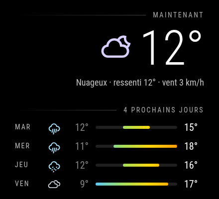

# MMM-Meteo

Module [MagicMirror²](https://magicmirror.builders) qui affiche la météo actuelle et les prochains jours, avec une barre de température par jour comme dans l'app Météo de l'iPhone. Les données viennent d'[Open-Meteo](https://open-meteo.com) : gratuit, sans clé, sans compte.



- **Un seul module, un seul appel** pour la météo actuelle et les prévisions, à la place des deux blocs du module `weather`.
- **Barres d'écart** : chaque jour va de sa minimale à sa maximale, sur une échelle commune à tous les jours. On voit d'un coup d'œil le jour le plus chaud et la nuit la plus froide.
- **La couleur du temps** : jaune au soleil, bleu sous la pluie, lilas la nuit, violet en cas d'orage.
- **Aucune dépendance** : les icônes sont celles de Weather Icons, déjà fournies avec MagicMirror.
- Textes en français (« Nuageux · ressenti 12° · vent 3 km/h »).

## Installation

```sh
cd ~/MagicMirror/modules
git clone https://github.com/FabienBounoir/MMM-Meteo.git
```

Pas de `npm install` nécessaire (Node 18 ou plus).

## Configuration

```js
{
	module: "MMM-Meteo",
	position: "top_right",
	config: {
		lat: 48.8566,
		lon: 2.3522,
		days: 4
	}
}
```

Pour trouver vos coordonnées : clic droit sur l'endroit voulu dans Google Maps, la première ligne du menu les donne.

| Option | Défaut | Description |
| --- | --- | --- |
| `lat` | — | Latitude du lieu (obligatoire) |
| `lon` | — | Longitude du lieu (obligatoire) |
| `days` | `4` | Nombre de jours de prévision, à partir de demain (jusqu'à 15) |
| `updateInterval` | `600` | Fréquence de mise à jour, en secondes |
| `label` | `"Maintenant"` | Titre au-dessus de la météo actuelle |

Le module garde le dernier affichage si Open-Meteo ne répond pas, et réessaie à l'intervalle suivant.

## Aller avec

Le design reprend celui de [MMM-NowPlayingOnSpotify](https://github.com/FabienBounoir/MMM-NowPlayingOnSpotify) et de [MMM-HAAgenda](https://github.com/FabienBounoir/MMM-HAAgenda) : mêmes étiquettes, mêmes chiffres fins, même usage de la couleur.

## Test

```sh
node test.js
```

## Licence

MIT
